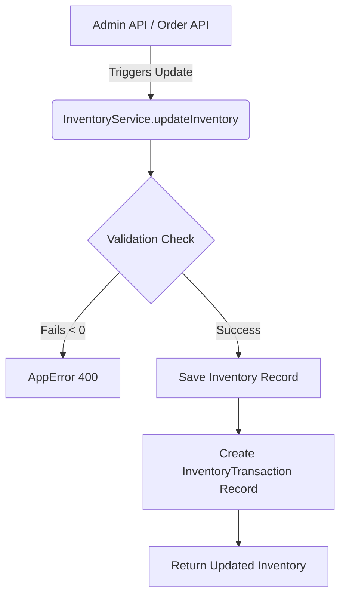

# Inventory API Architecture

## 1. Overview
The Inventory API acts as the central hub for stock management. To guarantee data integrity and auditability, we have introduced the `InventoryTransaction` schema alongside the `Inventory` schema.

## 2. Core Principles
- **No Direct Mutation**: `Inventory.availableStock` is never mutated independently. It is updated via the `InventoryService.updateInventory` method.
- **Mandatory Transactions**: Every single modification to an inventory record (whether triggered manually by an Admin or automatically by the Order API) creates a corresponding `InventoryTransaction` document detailing exactly *who* changed it, *what* order triggered it, and the *before/after* quantities.

## 3. Endpoints
| Method | Endpoint | Description | Required Permission |
| ------ | -------- | ----------- | ------------------- |
| POST | `/api/inventory` | Adjust stock / create | `inventory.update` |
| GET | `/api/inventory` | Get all stock / By Variant | `inventory.view` |

## 4. Flow Diagram

