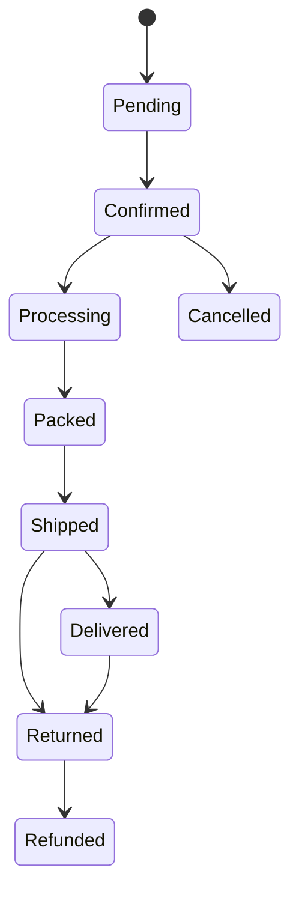

# Order API Architecture

## 1. Overview
The Order API is the core state machine of the business platform. It manages the lifecycle of customer purchases, handles synchronous inventory locking/release, and creates immutable snapshots of product data at the time of sale.

## 2. The State Machine
Transitions are strictly guarded inside the `OrderService`. Any invalid transition throws a `400 Bad Request`.

## 3. Order Item Snapshotting
When an order is created, the system copies `Product.title`, `ProductVariant.sku`, `price`, and `gstPercentage` directly into the `OrderItem` schema. If the marketing team changes the price of a variant a month later, historical receipts and order totals will remain mathematically sound and immutable.

## 4. Synchronous Inventory Integration
The `OrderService` natively communicates with the `InventoryService` logic within MongoDB transactions:
- **Confirmation**: `availableStock` is decreased, `reservedStock` is increased. An `InventoryTransaction` is written.
- **Shipping**: `reservedStock` is decreased.
- **Cancellation**: `availableStock` increases, `reservedStock` decreases.
- **Return**: `returnedStock` increases.

## 5. Endpoints
| Method | Endpoint | Description | Required Permission |
| ------ | -------- | ----------- | ------------------- |
| POST | `/api/orders` | Create an Order | `orders.manage` |
| GET | `/api/orders` | List Orders | `orders.view` |
| GET | `/api/orders/:id` | Get Order Details | `orders.view` |
| PATCH | `/api/orders/:id` | Update Order Status | `orders.manage` |
