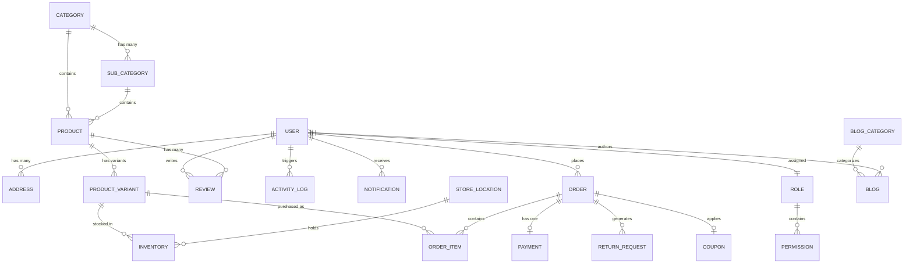

# Enterprise Database Architecture

This document maps the MongoDB architecture designed in Phase 4B. The database is highly normalized across 22 collections, decoupled for maximum horizontal scalability to support future Marketplace, Mobile App, and Multi-Vendor systems.

## 1. Entity-Relationship (ER) Diagram

## 2. Collection Relationships

### The Product Triad (High Scalability)
Instead of a giant monolithic Product model, we use a triad:
1.  **Product**: Global SEO data, global tags, brand, description, average rating.
2.  **ProductVariant**: The actual purchasable SKU. Contains specific images, size, color, and price.
3.  **Inventory**: Maps a Variant to a specific `StoreLocation` (Warehouse).

### The Order Snapshot
When an Order is placed, `Order` tracks the totals and status flow. `OrderItem` stores the `variant`, but also saves a hard snapshot of the `price` and `taxAmount` at the exact time of purchase, preventing historical financial data mutation if variant prices change later.

## 3. Index Strategy

Indexes are explicitly defined in schemas to optimize reads:
-   **User**: `{ email: 1 }`, `{ phone: 1 }`
-   **Product**: `{ slug: 1 }`, `{ category: 1 }`, `{ brand: 1 }`
-   **ProductVariant**: `{ sku: 1 }`, `{ product: 1 }`
-   **Inventory**: `{ variant: 1, warehouseLocation: 1 }` (Unique compound index)
-   **Order**: `{ orderNumber: 1 }`, `{ user: 1 }`, `{ status: 1 }`, `{ createdAt: -1 }`
-   **Coupon**: `{ code: 1 }`
-   **Review**: `{ product: 1 }`
-   **ActivityLog**: `{ createdAt: -1 }`

## 4. Query Optimization Strategy
-   **Lean Queries**: API routes should use `.lean()` whenever fetching data that doesn't need Mongoose document methods, vastly speeding up serialization.
-   **Population Limits**: Never blindly `.populate()`. Specify exact fields (e.g., `.populate('user', 'firstName lastName avatar')`) to save memory and bandwidth.

## 5. Soft Delete Strategy
Every schema (except logs) implements:
-   `isDeleted: Boolean`
-   `deletedAt: Date`
-   `deletedBy: ObjectId (User)`
This ensures historical consistency. E.g., deleting a ProductVariant does not break past Orders referencing it. Queries for active items must always append `{ isDeleted: false }`.

## 6. Audit Trail Architecture
The `ActivityLog` collection is a write-heavy, read-light table. Every critical mutation (status changes, inventory updates, role assignments) triggers a non-blocking log write. This guarantees compliance and traceback abilities for SuperAdmins.

## 7. Multi-Warehouse Inventory
By separating `Inventory` from `ProductVariant`, the system natively supports scaling to multiple warehouses (e.g., Pune, Mumbai). An order routing engine can later be built to fulfill orders from the closest warehouse with `availableStock`.

## 8. Multi-Currency Preparedness
The `User` schema stores `preferredCurrency`. The `Order` and `Payment` schemas explicitly record the `currency` string alongside the amount. While base pricing inside `ProductVariant` is currently absolute, the architecture natively supports dynamic currency conversion at the middleware layer later on.
